<!-- ================================================================= -->
<!-- 1. ANIMATED CONTRIBUTION GRAPH (Auto-refreshed daily via Actions) -->
<!-- ================================================================= -->

<h3><code>dev@github ~ $ ./contributions.sh</code></h3>

 
 

<!-- ================================================================= -->
<!-- 2. ASCII PORTRAIT + STATS METRICS (Side-by-side terminal windows) -->
<!-- ================================================================= -->

<h3><code>dev@github ~ $ whoami</code></h3>

<table>
<tr>
<td valign="top"></td>
<td valign="top"></td>
</tr>
</table>

 
 

<!-- ================================================================= -->
<!-- 3. NEOFETCH SYSTEM INFO                                           -->
<!-- ================================================================= -->

<h3><code>dev@github ~ $ neofetch</code></h3>

 
 

<!-- ================================================================= -->
<!-- 4. CURRENT FOCUS & ACTIVITY                                       -->
<!-- ================================================================= -->

<h3><code>dev@github ~ $ cat currently.md</code></h3>

<table>
<tr>
<td align="left" style="padding: 16px;">
  
🔭 <b>Currently building:</b> Real-time ML cyber defense simulation & live F1 telemetry trackers

  
🌱 <b>Currently exploring:</b> Advanced machine learning, cloud microservices & scalable backend design

  
💬 <b>Ask me about:</b> Python, Flask, REST APIs, PostgreSQL, full-stack architecture & data telemetry

  
⚡ <b>Fun fact:</b> Lifelong Formula 1 fanatic — fascinated by pitwall strategy and split-second analytics 🏎️

</td>
</tr>
</table>

 
 

<!-- ================================================================= -->
<!-- 5. TECH ARSENAL                                                   -->
<!-- ================================================================= -->

<h3><code>dev@github ~ $ cat tech-stack.json</code></h3>

  
  
  
  
  
  
  
  
  
  

 
 

<!-- ================================================================= -->
<!-- 6. FEATURED PROJECTS SHOWCASE                                     -->
<!-- ================================================================= -->

<h3><code>dev@github ~ $ ./featured-projects.sh</code></h3>

<table>
<tr>
<td width="50%" valign="top">
  <h4>🛡️ <a href="https://github.com/dev-gabani/cyber-defense-simulator">cyber-defense-simulator</a></h4>
  
Real-time cyber attack simulation & anomaly detection engine powered by ML with a live interactive dashboard.

  

    
    
    
  

</td>
<td width="50%" valign="top">
  <h4>💳 <a href="https://github.com/dev-gabani/smart-expense-app">smart-expense-app</a></h4>
  
Full-stack expense tracking web app with budgeting analytics, AI suggestions, REST API, and cloud PostgreSQL.

  

    
    
    
  

</td>
</tr>
<tr>
<td width="50%" valign="top">
  <h4>🏎️ <a href="https://github.com/dev-gabani/f1-pitwall">f1-pitwall</a></h4>
  
Formula 1 pitwall interface tracking live race telemetry, driver gaps, tyre strategies, and lap pace.

  

    
    
    
  

</td>
<td width="50%" valign="top">
  <h4>🛍️ <a href="https://github.com/dev-gabani/suhani-fashion">suhani-fashion</a></h4>
  
Modern fashion e-commerce storefront with catalog filtering and responsive modern styling.

  

    
    
  

</td>
</tr>
</table>

 
 

<!-- ================================================================= -->
<!-- 7. SOCIAL & TERMINAL LINKS                                        -->
<!-- ================================================================= -->

<h3><code>dev@github ~ $ ./connect.sh</code></h3>

<b>Full-Stack Developer · Security Enthusiast · F1 Fanatic</b>

 

